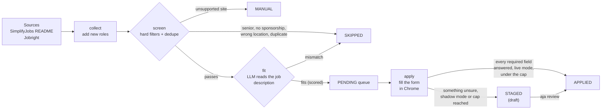
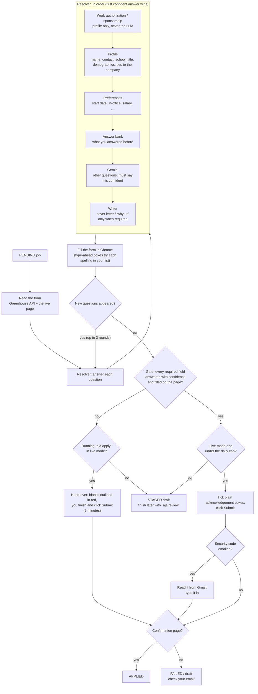

# auto-job-applier

A personal command-line pipeline that finds new-grad and early-career software engineering roles,
screens them against your resume, and fills out the applications for you in a real browser. It
submits an application on its own only when every required question has a confident answer;
anything it is unsure about becomes a draft that you finish yourself.

The command is `aja`. Today it applies on **Greenhouse**. Lever and Workday are planned.

> [!IMPORTANT]
> This tool fills in real job applications under your name. It starts in **shadow mode**: it
> fills forms but never clicks Submit until you turn live mode on yourself (see
> [Safety](#safety-shadow-mode-and-the-daily-cap)).

## Contents

- [How it works](#how-it-works)
- [What happens to one application](#what-happens-to-one-application)
- [Requirements](#requirements)
- [Setup](#setup)
- [Everyday use](#everyday-use)
- [Command reference](#command-reference)
- [Your profile](#your-profile)
- [Safety: shadow mode and the daily cap](#safety-shadow-mode-and-the-daily-cap)
- [Where your data lives](#where-your-data-lives)
- [Project layout](#project-layout)
- [Development](#development)

## How it works

Every job moves through one pipeline and is stored in a local SQLite database with a status.



| Status    | Meaning                                                                    |
|-----------|----------------------------------------------------------------------------|
| `NEW`     | Collected, not screened yet                                                |
| `SKIPPED` | Filtered out (the reason says why: senior title, no sponsorship, closed…)  |
| `PENDING` | Passed screening and the fit check; waiting to be applied to               |
| `STAGED`  | A draft: filled as far as possible, waiting on you                         |
| `APPLIED` | Submitted, and the confirmation page was seen                              |
| `FAILED`  | Something went wrong after Submit was clicked; check your email            |
| `MANUAL`  | A good fit, but on a site the tool can't fill yet (Workday, Lever, …)      |

## What happens to one application

This is what `aja apply <id>` (and each job inside `aja run`) does.



A few rules hold everywhere:

- **Never guess a required field.** If an answer isn't confident, the field stays blank and the
  job becomes a draft (or is handed to you).
- **Work authorization and sponsorship** answers come only from your profile.
- **Fact boxes are never ticked for you.** A box like "I certify I am a U.S. citizen" is handed to
  you; only plain "I have read / I acknowledge" boxes are ticked automatically.
- Every answer you give in `aja review` is saved in the **answer bank** and reused next time the
  same question comes up.

## Requirements

- macOS (the daily schedule uses launchd and notifications; everything else also runs on Linux)
- Python 3.12 or newer
- Google Chrome / Chromium via Playwright
- A free [Gemini API key](https://aistudio.google.com/apikey) in `GEMINI_API_KEY`
- Optional: a Gmail [app password](https://myaccount.google.com/apppasswords), so the tool can read
  the security codes Greenhouse sometimes emails after Submit

## Setup

```bash
git clone https://github.com/Teklemya/auto-job-applier.git
cd auto-job-applier
python3 -m venv .venv && .venv/bin/pip install -e ".[dev]"
.venv/bin/playwright install chromium
source .venv/bin/activate          # puts `aja` on your PATH

echo 'export GEMINI_API_KEY="..."' >> ~/.zshrc   # your key; never commit it

aja init          # creates ~/.auto-job-applier with an example profile
# edit ~/.auto-job-applier/profile.yaml and copy your resume next to it
aja check         # validates the profile
aja login         # sign into Jobright and Google once, in the tool's own Chrome
aja login-mail    # optional: Gmail app password for emailed security codes
```

## Everyday use

```bash
aja schedule --at 9:30pm   # once: run every evening, with a notification when done
aja last                   # what tonight's run did
aja review                 # list drafts that need you
aja review 341             # answer what's missing, re-fill the form, submit it yourself
```

Or drive it by hand:

```bash
aja collect                # new roles from SimplifyJobs and Jobright, screened
aja fit --limit 40         # LLM fit check on the queue
aja list --status pending  # what's waiting
aja apply 341              # fill (and, in live mode, submit) one job
aja run --limit 10         # all of the above in one pass
```

## Command reference

### Setup and health

| Command | What it does |
|---|---|
| `aja init` | Creates `~/.auto-job-applier/` with an example `profile.yaml` and an empty database. |
| `aja check` | Validates `profile.yaml` and prints any problems. |
| `aja login` | Opens the tool's own Chrome profile so you can sign into Jobright and Google once. |
| `aja login-mail` | Stores a Gmail app password in the macOS Keychain, so submits can read emailed security codes. |
| `aja mail-check COMPANY [--since TIME]` | Debugging: shows which emails the code reader finds for a company and why it skips each one. |
| `aja stats` | Job counts by ATS and status. |

### Finding and screening jobs

| Command | What it does |
|---|---|
| `aja collect [--source all\|simplify\|jobright] [--file README.md]` | Adds open SWE roles to the queue, then screens them: senior titles, roles marked no-sponsorship or citizenship-required, locations you didn't target, and duplicates are skipped. `--file` parses a saved SimplifyJobs README instead of fetching it. |
| `aja fit [--limit N]` | Fetches each queued job's description and asks Gemini how well it fits your resume. Verdicts in `settings.fit_skip` (default `mismatch`) are skipped; the score orders the queue. Batched to stay in the free tier. |
| `aja list [--status S] [--ats A] [--limit N]` | Lists jobs in the queue, filtered by status or ATS. |
| `aja write JOB_ID [--why]` | Prints the cover letter (or "why us" answer) the tool would write for a job, so you can check the tone. Submits nothing. |

### Applying

| Command | What it does |
|---|---|
| `aja apply JOB_ID [--retry]` | Fills one Greenhouse application in Chrome. It submits only in live mode, under the daily cap, when every required field is answered. If something is missing in live mode, the form is handed to you for 5 minutes with the blanks outlined in red. `--retry` submits again after a click that didn't go through (check your email first, so you don't apply twice). |
| `aja run [--limit N] [--file F] [--notify]` | One unattended pass: collect, screen, fit-check, then apply to the top `N` Greenhouse jobs (default 5). A source or job that fails is reported and the run goes on. `--notify` is what the schedule uses: it marks the log and shows a macOS notification. |
| `aja review [JOB_ID]` | With no id, lists drafts and manual jobs. With an id, asks you for each missing answer (saved to the answer bank), re-fills the form, and lets you submit it yourself. |

### The daily run

| Command | What it does |
|---|---|
| `aja schedule --at 9:30pm` | Installs a launchd job that runs `aja run --limit 10 --notify` every day at that time. A run missed while the Mac slept starts when it wakes. Running it again replaces the time. |
| `aja schedule` | Shows the current schedule. |
| `aja schedule --off` | Removes the daily run. |
| `aja last` | Shows the output of the most recent scheduled run (from `~/.auto-job-applier/logs/run.log`). |

The scheduled job starts through an interactive `zsh`, so it gets `GEMINI_API_KEY` from your
`~/.zshrc` and no secret is written into the launchd file. Only one `aja run` or `aja apply` runs at
a time; a scheduled run that finds `aja apply` busy waits up to 30 minutes.

## Your profile

Everything the tool says about you comes from `~/.auto-job-applier/profile.yaml`. The annotated
example is [`src/auto_job_applier/profile.example.yaml`](src/auto_job_applier/profile.example.yaml).
Its sections:

| Section | Used for |
|---|---|
| `contact`, `address`, `links` | Name, email, phone, location, LinkedIn, GitHub, portfolio |
| `work_authorization` | Authorization, sponsorship, citizenships, and exact sentences you approve for sentence-style options |
| `education` | School, degree, major (each with alternate spellings), dates, GPA |
| `experience` | Current company and title, past employers, family at companies, non-compete |
| `demographics` | Voluntary EEO answers; each can be a list of spellings in order of preference, e.g. `veteran_status: ["I am not a protected veteran", "No military service"]` |
| `preferences` | Start date, salary, in-office, engineering focus, office locations, consent and acknowledgement ticking |
| `targeting` | Which locations and roles to collect |
| `settings` | `submit` (live mode), `daily_submit_cap`, `fit_skip` |
| `resume_path` | Your resume, relative to the profile |

## Safety: shadow mode and the daily cap

- `settings.submit: false` (the default) is **shadow mode**: forms are filled and saved as drafts,
  never submitted. Set it to `true` yourself when you trust the drafts.
- `settings.daily_submit_cap` (default 3) limits automatic submits per day. Every click on Submit
  counts, including ones that didn't reach a confirmation page.
- An application that was clicked once is never submitted again automatically; `aja apply --retry`
  is the deliberate way to try again.
- Both settings are only ever changed by you, by hand.

## Where your data lives

Personal data stays on your machine in `$AJA_HOME` (default `~/.auto-job-applier/`) and is never
committed:

```
~/.auto-job-applier/
├── profile.yaml      # you
├── resume.pdf
├── jobs.db           # every job, its status, drafts, answer bank, events
├── browser-profile/  # the tool's own Chrome profile
├── artifacts/        # screenshots of each filled form
├── logs/run.log      # scheduled runs (`aja last`)
└── apply.lock        # one run at a time
```

The Gmail app password lives in the macOS Keychain. `GEMINI_API_KEY` lives in your shell profile.

## Project layout

```
src/auto_job_applier/
├── cli.py            # the `aja` commands (Typer)
├── sources/          # SimplifyJobs README parser, Jobright, ATS detection
├── screen.py         # hard filters and dedupe
├── fit.py            # LLM fit check
├── jd_fetch.py       # job descriptions
├── answers/
│   ├── resolver.py   # question → answer: profile, preferences, bank, LLM; the submit gate
│   ├── bank.py       # remembered answers
│   ├── writer.py     # cover letters and "why us"
│   └── facts.py      # what the LLM is told about you
├── engines/
│   ├── base.py       # fill plan, packets, submit results
│   └── greenhouse.py # reading, filling and submitting Greenhouse forms (Playwright)
├── apply.py          # one application end to end: fill rounds, gate, submit, hand-over
├── review.py         # finishing drafts
├── inbox.py          # Gmail security codes
├── schedule.py       # launchd daily run, notifications, `aja last`
├── llm.py            # Gemini client with quota handling
├── store.py          # SQLite
└── profile.py        # profile schema and validation
tests/                # pytest; fixtures/ holds saved real pages and forms
docs/SPEC.md          # the spec
tasks/                # plan and task list
```

## Development

```bash
.venv/bin/pytest -q                                          # tests
.venv/bin/ruff check . && .venv/bin/ruff format --check .    # lint and format
```

- Tests never touch live sites or the real Gemini API; they use saved fixtures and stubs, and set
  `AJA_HOME` to a temporary folder. Browser tests skip when no Chromium is installed.
- Work happens on one branch per phase (`phase-N-*`), one commit per task, with a pull request into
  `main` at each checkpoint (regular merge).
- See [`docs/SPEC.md`](docs/SPEC.md) for requirements and [`tasks/todo.md`](tasks/todo.md) for
  what's done and next.
